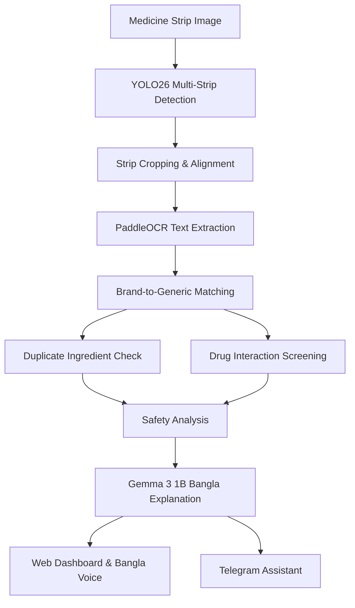

# OushudhCheck
### Multi-Strip Medicine Safety Scanner & Bangla Voice Assistant

**Know Your Medicines. Protect Your Health.**

OushudhCheck is an AI-powered medicine safety platform designed to help people identify medicines, detect duplicate active ingredients, and screen potential drug interactions by scanning multiple medicine strips in a single image.

The platform combines computer vision, OCR, pharmaceutical data matching, drug-interaction screening, and Bangla AI voice assistance to make medicine information more accessible to everyone.

---

## The Problem

Different medicine brands can contain the same active ingredient. For example, Napa and Ace are different brands, but both can contain Paracetamol.

Without knowing their generic ingredients, people may accidentally take duplicate medicines or combine drugs that could interact.

This becomes even more challenging when:

- Medicine cartons or prescriptions are unavailable.
- Generic names are printed in tiny text on blister strips.
- Users are unfamiliar with medical terminology.
- Patients and caregivers have difficulty understanding medicine information in English.

**OushudhCheck aims to make medicine identification and safety information easier to understand.**

## Our Solution

With OushudhCheck, users can place **2–6 medicine strips** together, capture a single photo, and receive an AI-assisted medicine safety analysis.

The platform is designed to:

1. Detect multiple medicine strips from one image.
2. Extract brand names and strengths using OCR.
3. Match Bangladeshi medicine brands with their generic ingredients.
4. Identify duplicate active ingredients.
5. Screen potential drug-drug interactions.
6. Present understandable medicine information and Bangla voice guidance.
7. Provide an alternative interaction channel through a Telegram bot.

## Key Features

### 1. AI-Powered Multi-Strip Detection
Uses YOLO26-based computer vision to detect and locate multiple medicine blister strips in a single image, including rotated and partially covered strips.

### 2. Intelligent Foil Text Recognition
Uses RapidOCR (PP-OCRv6 ONNX) to extract medicine names and strength information from blister-pack images.

### 3. Bangladesh Medicine Database
Matches extracted brand names against a curated index containing **17,191 Bangladeshi medicine brand records** and **1,661 generic entries**.

### 4. Duplicate Ingredient Detection
Identifies medicines that contain the same active ingredient, even when they have different brand names.

**Example:** Napa + Ace → Paracetamol + Paracetamol.

### 5. Drug Interaction Screening
Checks identified generic compounds against a structured Drug-Drug Interaction (DDI) knowledge graph to flag potential interactions and contraindications.

### 6. Bangla AI Voice Assistant
Uses a compact language model to generate patient-friendly explanations in Bangla, with voice output to make medicine information easier to understand.

### 7. Telegram Medicine Assistant
Allows users to interact with the system through Telegram by sending medicine-strip photos or Bangla voice messages.

---

## How It Works



## Technology Stack

| Component | Technology |
|---|---|
| Frontend | Next.js, React, TypeScript |
| Computer Vision | YOLO26 |
| OCR | PaddleOCR |
| Backend / API | Python, FastAPI |
| Brand Matching | RapidFuzz, Phonetic Indexing |
| Medicine Database | Curated Bangladesh Medicine Dataset |
| Interaction Screening | DrugBank DDI Dataset / Knowledge Graph |
| Language Model | Gemma 3 1B (Fine-Tuned Q4_K_M GGUF via llama.cpp) |
| Voice Input | Whisper |
| Voice Output | Bangla Text-to-Speech |
| Deployment Format | ONNX, GGUF (planned pipeline) |
| Communication | Telegram Bot |

## AI Pipeline

OushudhCheck combines multiple AI and data-processing components rather than depending on a single language-model prompt.

| Stage | What it does |
|---|---|
| Vision | Detects and localizes medicine strips |
| OCR | Extracts printed brand names and strengths |
| Entity Resolution | Matches noisy OCR text with medicine records |
| Safety Engine | Checks duplicate ingredients and potential interactions |
| Language Generation | Converts structured findings into understandable Bangla |
| Voice & Delivery | Delivers results through the web app and Telegram |

## Quick Start (One-Command Docker)

Run the entire stack (**Gemma 3 1B auto-downloaded from GitHub Releases** + `llama-server` + FastAPI + Next.js + Telegram Bot) with a single command:

```bash
docker compose up --build
```

- **First run**: `model-init` automatically downloads `oushudhcheck_gemma3_1b_deploy.zip` from GitHub Releases into the persistent `oushudhcheck_models` volume and extracts `oushudhcheck-gemma3-1b-bn.Q4_K_M.gguf` + `system_prompt.txt`. Subsequent restarts skip the download.
- **Services**: Frontend `http://localhost:3000` • Backend API `http://localhost:8000/docs` • Gemma 3 1B SLM `http://localhost:8081`
- **Kubernetes-ready**: `model-init` maps 1:1 to a Kubernetes `initContainer` writing to a shared `ReadWriteMany` PVC, allowing `slm` and `backend` pods to scale horizontally while mounting `/models` read-only.

## Project Goals

- Make medicine information more accessible to people in Bangladesh.
- Reduce confusion between different brands containing the same generic ingredient.
- Help users recognize potential medication duplication and interaction risks.
- Improve accessibility through Bangla explanations and voice interaction.
- Explore lightweight AI models for practical healthcare applications.

## Team OushudhCheck

### Jubayer Ahmed
**Frontend & AI Product Engineer**

Building OushudhCheck's Next.js frontend and intuitive AI-powered medicine scanning interface.

- GitHub: [@Jubayerx17](https://github.com/Jubayerx17)
- Email: jubayer.ahm17@gmail.com

### Ridoy Hossan Rony
**Backend & ML Systems Engineer**

Building the YOLO26 blister detector, FastAPI inference engine, 21K+ BD drug resolver, and Bangla SLM pipeline.

- GitHub: [@rhridoyhossan](https://github.com/rhridoyhossan)
- Email: rhridoyhossan@gmail.com

---

## Important Medical Disclaimer

OushudhCheck is an AI-assisted medicine information and safety-screening tool. Its results may contain errors and should not be treated as a medical diagnosis, prescription, or replacement for professional medical advice.

Always consult a qualified healthcare professional before starting, stopping, or changing medication. Do not use AI-generated guidance as a substitute for a doctor's instructions.

---

## Our Vision

We believe understanding medicine should not require advanced medical knowledge or fluency in English.

**Our goal is simple: make medicine information easier to understand, more accessible, and safer for everyone.**

---

<p align="center">
  <strong>OushudhCheck: Know Your Medicines. Protect Your Health.</strong>
</p>
