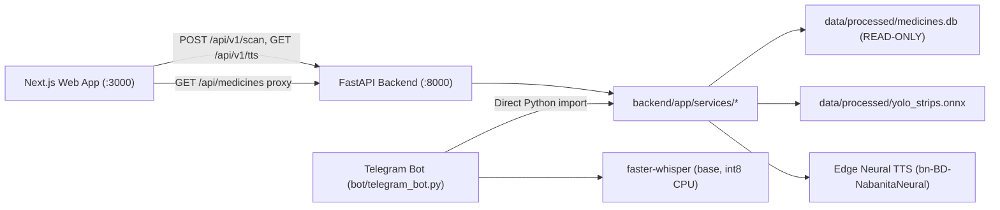

# OushudhCheck — Agent & Developer Guide (`agent.md`)

> **Multi-Strip Medicine Safety Scanner & Bangla Voice Assistant**
> Built for **CoU AI Hackathon 2026** (Healthcare & Accessibility).

This document is the authoritative orientation and operational guide for AI agents and developers working in this repository. Every path, symbol, command, and invariant below reflects the actual codebase.

---

## 1. System Overview & Architecture

OushudhCheck identifies 1–6 Bangladeshi medicine blister strips from a single photo, resolves brand names and dosage strengths (`mg`, `mcg`, `ml`, `IU`) against a local SQLite database of **17,191 brands / 1,661 generics**, checks for **duplicate active ingredients** and **drug-drug interactions (DDI)**, and delivers patient-friendly **Bangla summaries and neural voice guidance** across a Next.js web app and a Telegram bot (`@OushudhCheck_bot`).



### Key Architectural Facts
- **No external database server**: All pharmaceutical data lives in `data/processed/medicines.db` (SQLite, ~20 MB).
- **Telegram bot does not call FastAPI over HTTP**: `bot/telegram_bot.py` uses raw `aiohttp` long-polling (`getUpdates`) and imports `backend.app.services.{ocr,slm,voice}` directly in-process.
- **Deterministic Grounded Bangla NLG**: `backend/app/services/slm.py` (`SafetySLMEngine` + `generate_bangla_beginner_summary`) runs fast deterministic clinical templates grounded strictly in `medicines.db` rather than loading multi-GB LLM weights at runtime.
- **Zero-crash ONNX bootstrap**: `StripDetector` (`backend/app/services/detector.py`) loads `data/processed/yolo_strips.onnx` via `onnxruntime` (`CPUExecutionProvider`) and falls back to OpenCV contour proposals if using the minimal identity graph; if the volume is read-only (`:ro`), it falls back to `<tempdir>/yolo_strips.onnx`.

---

## 2. Repository Structure

| Path | Purpose |
|---|---|
| `backend/app/main.py` | FastAPI app factory, CORS middleware (`ALLOWED_ORIGINS`), mounts router at `/api/v1` and `/api`, `GET /health`. |
| `backend/app/core/config.py` | Path resolution (`DB_PATH`, `YOLO_MODEL_PATH`), thresholds (`MIN_FUZZY_SCORE`, `MAX_STRIPS_PER_IMAGE`, `OCR_LANG`), `get_readonly_db_connection()`. |
| `backend/app/api/routes.py` | All REST endpoints (`/medicines`, `/medicines/search`, `/scan`, `/scan-benchmark`, `/extract-text`, `/extract-multi-text`, `/tts`, `/benchmark-samples`, `/demo-image/{sample_id}`). |
| `backend/app/models/schemas.py` | Pydantic v2 schemas (`MedicineItem`, `PaginatedMedicinesResponse`, `MedicineInfo`, `StripScanResult`, `SafetyAlert`, `MultiStripScanResponse`). |
| `backend/app/services/detector.py` | `StripDetector`: YOLO ONNX / Ultralytics / OpenCV contour detection + LAB-CLAHE foil glare removal (`preprocess_for_ocr`). |
| `backend/app/services/ocr.py` | `OCREngine` (RapidOCR ONNX primary, 0° + 90° CCW), `MedicineMatcher` (RapidFuzz + SQLite + EDCL virtual records), `evaluate_multi_strip_safety()`, `MedicineStripScanner`. |
| `backend/app/services/slm.py` | `SafetySLMEngine` (ghost-brand suppression, strength ordering, schedule & interaction guidance) and `generate_bangla_beginner_summary()`. |
| `backend/app/services/voice.py` | `transcribe_bangla_audio()` (`faster-whisper` base/int8) and `synthesize_bangla_speech()` (`edge-tts` with atomic SHA-256 disk cache + LRU eviction). |
| `bot/telegram_bot.py` | Async `aiohttp` Telegram bot supporting photo scans (5-stage live `editMessageText`), Bangla voice queries, and text queries. |
| `frontend/` | Next.js 16.4.6 App Router + React 19.3 + TypeScript 5 + Tailwind CSS 4 + shadcn/ui (`@base-ui/react`). See `frontend/AGENTS.md` for Next.js 16 specific rules. |
| `frontend/app/page.tsx` | Landing page (`HeroSection`, `HealthcareShowcaseCard`, `ServicesGrid`, `AboutTeamSection`). |
| `frontend/app/scan/page.tsx` | Medicine strip scanner workspace (`components/medicine-scanner-workspace.tsx`). |
| `frontend/app/database/page.tsx` | Searchable & paginated BD medicine directory (`components/medicine-database-directory.tsx`). |
| `frontend/app/pipeline/page.tsx` | Live 6-stage AI Pipeline & Transparency Inspector (`components/ai-transparency-inspector.tsx`). |
| `frontend/app/api/medicines/route.ts` | Next.js Route Handler proxying `/api/medicines` to FastAPI (`INTERNAL_API_URL` -> `NEXT_PUBLIC_API_URL`) with a local Python `sqlite3` read-only fallback. |
| `frontend/lib/` | `api.ts` (FastAPI client), `types.ts` (shared TS interfaces), `mock-data.ts` (preset demo data), `utils.ts`. |
| `data/processed/` | `medicines.db` (read-only SQLite), `yolo_strips.onnx`, `beginner_summary_report.md`. |
| `scripts/` | `ingest_drugs.py` (CSV -> SQLite), `generate_beginner_summaries.py`, `benchmark.py` (evaluates `test/` images). |
| `ml_training/` | Colab/Kaggle training notebooks for YOLO and SLM experiments. |
| `test/` | Local gitignored folder of real medicine strip photos used by `scripts/benchmark.py` and `/scan-benchmark`. |

---

## 3. Tech Stack & Runtime Dependencies

- **Backend**: Python 3.12, FastAPI, Uvicorn, Pydantic v2, OpenCV (`opencv-python-headless`), RapidOCR (`rapidocr`), ONNXRuntime (`onnxruntime`), RapidFuzz (`rapidfuzz`), `faster-whisper`, `edge-tts`.
- **Frontend**: Node 20+, Next.js 16.4.6 (Turbopack, `cacheComponents: true`), React 19.3, TypeScript 5 (`strict: true`), Tailwind CSS 4.3.3, Lucide Icons, Sonner, GSAP, Lenis, `react-dropzone`, `react-webcam`.
- **Bot**: Python 3.12, `aiohttp`, `python-dotenv`, plus backend ML/voice services (`bot/requirements.txt` includes `-r ../backend/requirements.txt`).
- **Containers**: `Dockerfile` (Python 3.12-slim for backend & bot), `frontend/Dockerfile` (multi-stage Node 20-alpine production build), `docker-compose.yml`.

---

## 4. Environment Variables

Copy `.env.example` to `.env` at the repository root:

| Variable | Default | Used By | Purpose |
|---|---|---|---|
| `TELEGRAM_BOT_TOKEN` | *(required for bot)* | `bot/telegram_bot.py` | Telegram Bot API token from `@BotFather`. |
| `TELEGRAM_BOT_USERNAME` | `OushudhCheck_bot` | `bot/telegram_bot.py` | Bot handle displayed in `/start`. |
| `NEXT_PUBLIC_API_URL` | `http://localhost:8000/api/v1` | `frontend/` (client + build) | Browser-reachable FastAPI base URL. |
| `INTERNAL_API_URL` | *(falls back to `NEXT_PUBLIC_API_URL`)* | `frontend/app/api/medicines/route.ts` | Server-to-server FastAPI URL inside Docker (`http://backend:8000/api/v1`). |
| `MEDICINES_DB_PATH` | `data/processed/medicines.db` | `backend/`, `frontend/app/api/medicines` | Path to SQLite database. |
| `ALLOWED_ORIGINS` | `http://localhost:3000,http://127.0.0.1:3000` | `backend/app/main.py` | Comma-separated CORS origins. |
| `YOLO_MODEL_PATH` | `data/processed/yolo_strips.onnx` | `backend/app/core/config.py` | Path to ONNX/YOLO strip detector weights. |
| `MIN_FUZZY_SCORE` | `72.0` | `backend/app/core/config.py` | Minimum RapidFuzz match score. |
| `MAX_STRIPS_PER_IMAGE` | `6` | `backend/app/core/config.py` | Maximum strips proposed per photo. |
| `OCR_LANG` | `en` | `backend/app/core/config.py` | OCR language setting. |

---

## 5. Development, Build & Verification Commands

### Windows Local Full-Stack Launcher
```bat
run_local.bat
```

### Individual Services
```bash
# Backend (from repo root)
uvicorn backend.app.main:app --reload --host 0.0.0.0 --port 8000

# Frontend (from frontend/)
cd frontend
npm run dev      # Dev server on http://localhost:3000
npm run lint     # ESLint (Next.js + React 19 compiler rules)
npx tsc --noEmit # TypeScript strict typecheck
npm run build    # Production build

# Telegram Bot (from repo root)
python bot/telegram_bot.py

# Benchmark against test/ photos
python scripts/benchmark.py
```

### Docker Compose
```bash
docker compose up --build
```
Services exposed:
- Web App: `http://localhost:3000`
- FastAPI Backend & Swagger Docs: `http://localhost:8000/docs`
- Health Check: `http://localhost:8000/health`

---

## 6. Critical Invariants & Coding Conventions

Follow these strictly when modifying the codebase:

1. **Read-Only Database Invariant**:
   - `data/processed/medicines.db` MUST ONLY be opened in SQLite read-only URI mode (`?mode=ro`) and closed via `contextlib.closing(...)` or `try/finally: conn.close()`. (Note: Python's `with sqlite3.connect(...)` manages transactions, **not** connection closure.)
   - Always escape `%`, `_`, and `\` with `ESCAPE '\'` when using SQL `LIKE` on user input.
   - Never mutate `medicines.db` from runtime API or bot code.

2. **Thread-Safe & Non-Blocking FastAPI Inference**:
   - `get_scanner()` is a process-wide `@lru_cache(maxsize=1)` singleton. Never store per-request mutable state on `scanner` (use `scanner.scan_image_with_timings(image)` which returns timings per call).
   - Never run synchronous OpenCV/ONNX/RapidOCR/SQLite work directly inside `async def` handlers — either declare the route as regular `def` or offload with `await run_in_threadpool(...)`.
   - Enforce upload byte caps (`MAX_UPLOAD_BYTES = 15 MB`) and decoded pixel limits (`MAX_IMAGE_PIXELS = 25_000_000`) on image upload routes.

3. **Clinical Safety & Honest Error Handling**:
   - Never silently fall back to fake/mock medicine results when a user uploads a real photo and the backend fails. Propagate errors and show an explicit error toast.
   - On `/scan`, require an uploaded or captured image before enabling `Scan Uploaded Photo` / Step 5 Summary.
   - In `evaluate_multi_strip_safety()`, check DDI across non-overlapping ingredients even when two combination strips share an ingredient, and mark all pairwise combinations of duplicate strips in `_build_safety_edges()`.

4. **Backend Dual-Import Convention**:
   - Modules under `backend/app/` use `try: from backend.app... except ImportError: from app...` so the backend runs cleanly from both repo root (`uvicorn backend.app.main:app`) and `backend/`.

5. **Frontend React 19, Lenis & Media Rules**:
   - Read `frontend/AGENTS.md` before editing Next.js configuration or App Router features.
   - **React 19 ESLint rules**: Never call `setState` synchronously inside a `useEffect` body (`react-hooks/set-state-in-effect`); derive state or update inside async callbacks / `useSyncExternalStore`.
   - **Blob URL & Audio Cleanup**: Always revoke `URL.createObjectURL()` URLs on replace/reset/unmount, abort in-flight `fetch()` calls with `AbortController`, and pause `HTMLAudioElement` + cancel `window.speechSynthesis` on unmount.
   - **Lenis SmoothScroll Modals**: `SmoothScroll` is mounted globally in `frontend/app/layout.tsx`. Every scrollable modal MUST include `data-lenis-prevent="true"`, `onWheel={(e) => e.stopPropagation()}`, `onTouchMove={(e) => e.stopPropagation()}`, body scroll locking, and `Escape`-to-close.
   - **Path Alias**: `@/*` maps to `frontend/*` (there is no `src/` directory).

6. **Telegram Bot Safety**:
   - Always escape dynamic strings with `html.escape()` before interpolating into `parse_mode="HTML"` messages.
   - Chunk multi-strip reports to `<= 3900` characters to stay below Telegram's 4096-character limit.
   - Offload CPU-bound OCR/Whisper/matching work via `await asyncio.to_thread(...)` and enforce download size limits + `aiohttp.ClientTimeout`.

7. **Design System Tokens**:
   - Deep Teal `#0b5563` · Emerald `#0ea86b` · Accent Teal `#0d9488` · Soft Mint `#e3f1ef` · Surface `#f2f9f8` · Ink `#09353c` · Muted `#46737a`.
   - Light-only theme (`<Toaster theme="light" ... />`).
